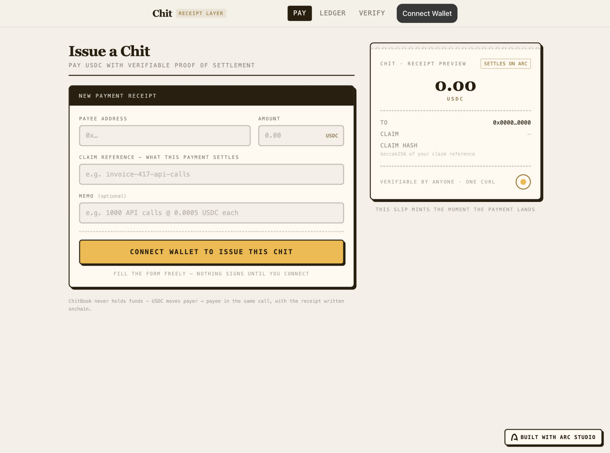
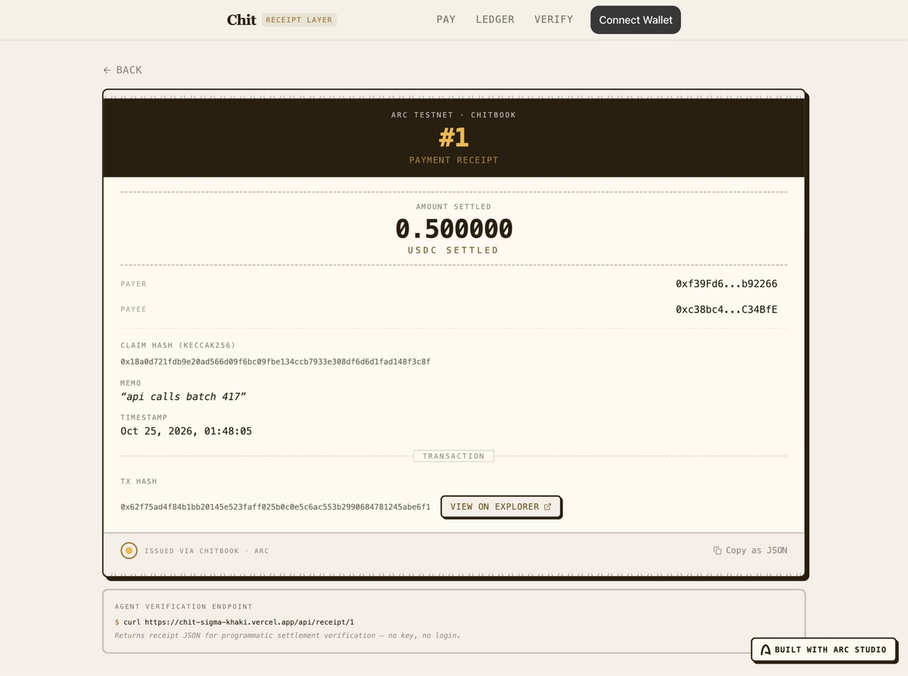

# Chit

Every USDC payment between agents gets a receipt anyone can check with one curl.

Chit is the receipt layer for agent-to-agent USDC payments on Arc. One service pays another, and the payment settles with a permanent onchain chit: who paid, who got paid, how much, and the claim that says why. No login, no indexer, no trust in either side's logs.

[](https://chit-sigma-khaki.vercel.app)
[](https://arc.io)
[](https://studio.arc.io)
[](LICENSE)

**[Live demo](https://chit-sigma-khaki.vercel.app)** · **[Proof receipts](#proof)** · **[How it works](#how-it-works)** · **[Arc Studio project](https://studio.arc.io/app/355cd223-1f8a-4932-8eab-20b459fd8d6a)**



## Proof

One real settlement receipt on Arc testnet, every row clickable. Verify any claim yourself with `bash verify.sh`: it reads the chain directly, no trusted server involved.

| # | Action | What it proves | Where |
|---|--------|----------------|-------|
| 1 | ChitBook deployed (`0xdaf2…a033`) | The receipt contract exists and is readable by anyone | [explorer](https://explorer.testnet.arc.io/address/0xdaf21c1619cd8361907eacad00e2415ac5aea033) |
| 2 | 0.5 USDC paid, chit #1 issued | `pay()` moves USDC payer to payee and records the receipt in one transaction | [tx](https://explorer.testnet.arc.io/tx/0x62f75ad4f84b1bb20145e523faff025b0c0e5c6ac553b2990684781245abe6f1) |
| 3 | `curl /api/receipt/1` returns the full record | Any agent verifies settlement with one HTTP GET | [api](https://chit-sigma-khaki.vercel.app/api/receipt/1) |

Machine-readable twin: [`proof.json`](proof.json).

## Contracts

| Contract | Network | Address | Explorer |
|----------|---------|---------|----------|
| ChitBook | Arc testnet (chain 5042002) | `0xdaf21c1619cd8361907eacad00e2415ac5aea033` | [view](https://explorer.testnet.arc.io/address/0xdaf21c1619cd8361907eacad00e2415ac5aea033) |

RPC: `https://rpc.testnet.arc.io` · USDC is native gas on Arc.

## What is real today

| Claim | Status |
|-------|--------|
| ChitBook contract, issued receipts, ledger, verify | Real, onchain, on Arc testnet |
| Public app + HTTP verification API | Real, deployed, linked above |
| Mainnet deployment | Next step: contract is mainnet-ready, deployment happens as soon as the burner wallet holds USDC for gas |
| Tx-hash links on receipts | Resolved from chain logs for recent receipts; the receipt record itself always resolves from contract state |

## How it works

```
payer (agent A)                    Arc (USDC = gas)
     │  approve + pay(claim)             │
     ├──────────────────────────────────▶│  USDC moves payer → payee
     │                                   │  receipt written in the same tx
     │◀── ReceiptIssued(id, claimHash) ──┤
     │                                   │
     │        anyone, anytime            │
     ├── app: ledger / verify  ◀─────────┤  contract reads
     └── curl /api/receipt/1   ◀─────────┘  HTTP proof
```

The whole verification surface is one call:

```bash
curl https://chit-sigma-khaki.vercel.app/api/receipt/1
# {"receipt":{"id":"1","payer":"0xf39F…2266","payee":"0xc38b…4BfE",
#   "amountUsdc":"0.500000","claimHash":"0x18a0…3c8f","memo":"api calls batch 417", …}}
```

The claim reference is hashed with keccak256 before it touches the chain, so a payer can prove what a payment was for without leaking the text. ChitBook never holds funds: USDC moves payer to payee inside `pay()`, and the receipt is written in the same transaction.

## The app



Issue a chit from the front door and the slip preview prints live as you type. After the payment lands, the full receipt carries the chit number, both addresses, the amount, the claim hash, and the explorer link. The [verify screen](docs/media/verify.jpg) resolves any receipt from four angles: chit number, plain claim text, keccak256 claim hash, or tx hash.

## Stack

React 18 · Vite · wagmi v2 · viem · ConnectKit · Tailwind · Solidity 0.8.28 · OpenZeppelin 5.6 · Foundry · Bun · Vercel edge functions · Arc Studio

## Run locally

```bash
bun install
cp .env.example .env        # ChitBook testnet address is prefilled
bun run dev                 # app on :5173
bun run server              # local API on :3001 in a second terminal
```

## Verify the claims

```bash
bash verify.sh
```

Reads `receiptCount` and `getReceipt(1)` straight from the Arc testnet RPC, checks the public API matches, and prints PASS or FAIL per claim.

## Project structure

```
src/components/    PayScreen · ReceiptPreview · LedgerScreen · VerifyScreen · ReceiptView
src/lib/           chitbook.ts (ABI + address) · txscan.ts (chunked log enrichment)
contracts/         ChitBook.sol (pays + records, never holds funds)
api/               Vercel edge functions: receipt · receipt-count
server/            local Bun API
scripts/           foundry deploy + e2e scenario
```

## Links

[Live app](https://chit-sigma-khaki.vercel.app) · [API](https://chit-sigma-khaki.vercel.app/api/receipt/1) · [ChitBook on explorer](https://explorer.testnet.arc.io/address/0xdaf21c1619cd8361907eacad00e2415ac5aea033) · [Arc Studio project](https://studio.arc.io/app/355cd223-1f8a-4932-8eab-20b459fd8d6a)

## License

MIT
